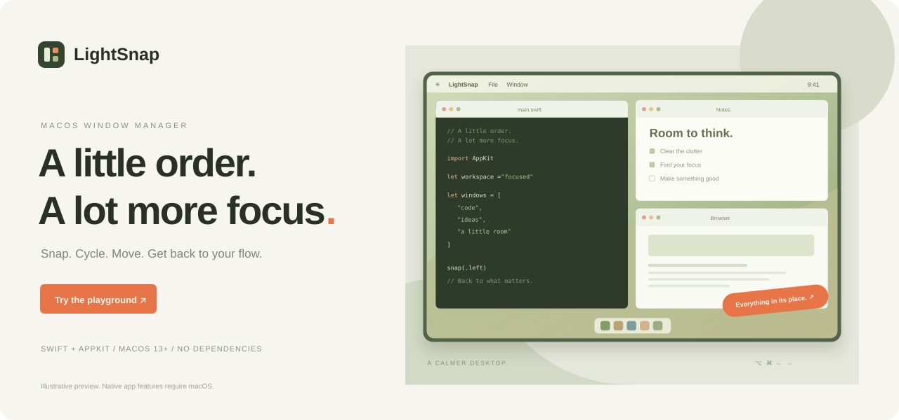
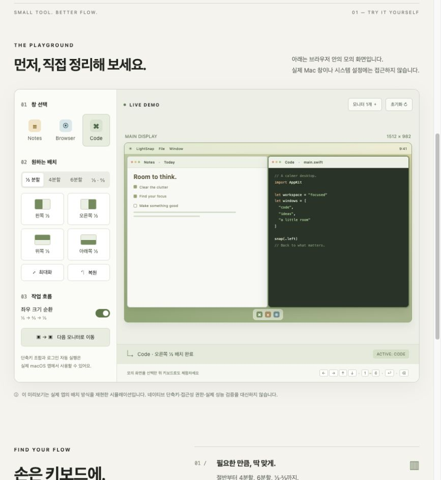

<div align="center">

<a href="https://github.com/kimyoung11/LightSnap/raw/refs/heads/main/preview/standalone.html"></a>

# LightSnap

**창 정리는 가볍게. 집중은 더 길게.**

단축키로 나만의 작업 공간을 만드는 macOS 메뉴 막대 유틸리티.


[**미리보기 HTML 다운로드 ↓**](https://github.com/kimyoung11/LightSnap/raw/refs/heads/main/preview/standalone.html) &nbsp; · &nbsp; [앱 시작하기](#빌드와-실행) &nbsp; · &nbsp; [단축키](#기본-단축키) &nbsp; · &nbsp; [개발 문서](#개발-인수인계와-확장-계획)

</div>

> 저장소는 **비공개**로 유지합니다. 미리보기는 로그인 연동 없는 **단일 HTML 파일**입니다. 파일을 받아 브라우저로 열거나 그대로 다른 사람에게 전달하면 됩니다. 비공개 GitHub에서 파일을 내려받을 때만 저장소 접근 권한이 필요합니다.

---

## 먼저, 직접 정리해 보세요

**[미리보기 HTML 다운로드 ↓](https://github.com/kimyoung11/LightSnap/raw/refs/heads/main/preview/standalone.html)**

`standalone.html`을 다운로드한 뒤 **더블클릭해 브라우저로 열면 됩니다.** ChatGPT 연결·앱 설치·로컬 서버가 필요 없습니다. 모의 창을 선택하고 배치할 수 있고, 파일 자체를 다른 사람에게 공유할 수도 있습니다.

GitHub의 HTML 파일 화면은 코드를 보여줍니다. Raw 다운로드 버튼으로 파일을 저장해 주세요.

<a href="https://github.com/kimyoung11/LightSnap/raw/refs/heads/main/preview/standalone.html"></a>

| 직접 체험할 수 있는 것 | 해보는 방법 |
| --- | --- |
| 절반·4분할·6분할·⅓·⅔ | 모의 창을 선택하고 배치 버튼 클릭 |
| 좌우 크기 순환 | 같은 좌우 버튼을 반복해 ½ → ⅔ → ⅓ |
| 모니터 이동 | 모니터를 2개로 바꾼 뒤 ‘다음 모니터’ 클릭 |
| 최초 배치 복원 | 여러 번 배치한 뒤 ‘복원’ 클릭 |
| 키보드 조작 | 모의 화면을 선택한 뒤 화살표·1–6·Enter·Backspace |

미리보기는 **브라우저 시뮬레이션**입니다. 실제 Mac 창 제어, 전역 단축키, 접근성 권한 확인, 로그인 자동 실행과 네이티브 성능 측정은 수행하지 않습니다. 상단 배너도 실제 앱 스크린샷이 아닌 디자인 일러스트입니다.

## 작지만, 작업 흐름에 맞게

| 기능 | 실제 macOS 앱에서 하는 일 |
| --- | --- |
| **Snap** | 좌우·상하 절반, 4분할, 6분할, ⅓·⅔로 작업 영역에 배치 |
| **Cycle** | 좌우 단축키를 반복해 같은 방향의 크기 변경 |
| **Move** | 다음 모니터로 상대 위치·크기를 유지해 이동 |
| **Restore** | 현재 실행 중 창별 최초 위치·크기 복원 |
| **Your shortcuts** | 전역 단축키 편집·저장, 중복과 등록 실패 안내 |
| **Stay ready** | 메뉴 막대 상주, 일시정지·재개, 로그인 자동 실행 설정 |
| **Local diagnostics** | 메모리·CPU·스냅 지연 확인, 사용자 선택 JSON 저장 |

---

## 빌드와 실행

**필요 환경:** macOS 13 이상, Swift 5.9 이상, Xcode Command Line Tools 또는 Xcode. 외부 Swift 패키지는 없습니다.

```sh
git clone https://github.com/kimyoung11/LightSnap.git
cd LightSnap
./scripts/build-app.sh
open dist/LightSnap.app
```

현재 저장소는 비공개이므로 clone에도 접근 권한이 필요합니다. 기본 빌드는 현재 Mac 아키텍처용 로컬 ad-hoc 서명 앱입니다. 앱을 다른 위치에서 사용할 경우 **권한을 허용하기 전에** 먼저 옮겨 주세요.

1. LightSnap 설정에서 **접근성 설정 열기**를 선택합니다.
2. 시스템 설정의 손쉬운 사용(접근성) 목록에서 실제 실행하는 `LightSnap.app`을 추가·허용합니다.
3. 앱을 종료·재실행하고 **권한 다시 확인 → 연결됨**을 확인합니다.
4. 다른 앱 창을 선택한 뒤 `⌥⌘←`를 눌러 보세요.

설정 창을 닫아도 메뉴 막대에서 실행됩니다. 완전히 종료하려면 메뉴의 **LightSnap 종료**를 선택합니다.

<details>
<summary><b>권한을 허용했는데 작동하지 않나요?</b></summary>

임시 서명 업데이트나 다른 경로의 앱 복사본 때문에 권한이 연결되지 않을 수 있습니다. 우선 **실행 중인 앱 보기**로 허용한 파일과 실행 파일이 같은지 확인하세요.

필요하면 실행 중인 LightSnap을 종료한 뒤 터미널에서 이 앱의 권한 기록만 초기화합니다.

```sh
tccutil reset Accessibility dev.lightsnap.mac
```

앱을 다시 실행하고 접근성 목록에 같은 앱 파일을 추가·허용한 뒤 종료·재실행합니다. **실행 정보 복사**로 단축키 수신과 권한 차단 여부를 구분할 수 있습니다. 복사한 정보에는 개인 경로 등이 포함될 수 있으니 공개 전에 확인해 주세요.

</details>

## 기본 단축키

모든 기본 조합은 `⌥ Option + ⌘ Command`를 포함합니다.

| 배치 | 추가 키 |
| --- | --- |
| 왼쪽 / 오른쪽 절반 | ← / → |
| 위쪽 / 아래쪽 절반 | ↑ / ↓ |
| 왼쪽 위 / 오른쪽 위 | U / I |
| 왼쪽 아래 / 오른쪽 아래 | J / K |
| 왼쪽 / 가운데 / 오른쪽 ⅓ | D / F / G |
| 왼쪽 / 오른쪽 ⅔ | E / T |
| 6분할 위쪽 왼쪽부터 | 1 / 2 / 3 |
| 6분할 아래쪽 왼쪽부터 | 4 / 5 / 6 |
| 작업 영역 최대화 | Return |
| 최초 배치로 복원 | Delete (⌫) |
| 다음 모니터로 이동 | ⌃ Control + → |

설정의 단축키 버튼을 누른 뒤 원하는 조합을 입력합니다. Command 또는 Control을 포함해야 하며, Esc는 취소, 수정키 없는 Delete는 해당 단축키 해제입니다. 문자 표시는 ANSI 물리 키 위치 기준입니다. 일부 macOS 예약 조합은 등록에 성공해도 전달되지 않을 수 있으므로 직접 확인해 주세요.

최대화는 macOS 전체 화면 모드가 아니라 Dock과 메뉴 막대를 제외한 작업 영역을 채우는 동작입니다.

<details>
<summary><b>모니터 이동 · 크기 순환 · 로그인 자동 실행 자세히 보기</b></summary>

### 모니터 이동과 크기 순환

- `⌃⌥⌘→`로 다음 모니터로 이동합니다. 화면은 왼쪽 → 오른쪽, 같은 x 좌표에서는 위 → 아래 순서로 순환합니다. 상대 위치·크기를 대상 작업 영역에 맞춰 환산하며, 모니터가 하나뿐이면 이동하지 않고 안내합니다.
- `⌥⌘←` 또는 `⌥⌘→`를 같은 창에서 반복하면 절반 → ⅔ → ⅓ → 절반 순으로 바뀝니다. 다른 창/방향으로 배치하거나 창 위치를 직접 바꾸면 절반부터 다시 시작합니다. 위·아래·4분할·6분할은 고정 배치입니다.
- **좌우 반복 시 크기 순환**을 끄면 기존처럼 좌우 단축키가 항상 절반 크기로 배치합니다.
- 이전 사용자 설정을 처음 읽을 때 기존 변경·해제 항목을 보존하고 새 모니터 이동 단축키만 추가합니다. 기존 사용자 조합과 겹치면 새 항목은 미설정으로 둡니다.

### 로그인 시 자동 실행

설정의 **로그인 시 자동 실행**에서 켜고 끕니다. 기본값은 꺼짐이며 앱이 자동으로 등록하지 않습니다. macOS의 `SMAppService.mainApp`을 사용하므로 별도의 상주 도우미·LaunchAgent를 설치하지 않습니다.

상태가 ‘사용자 승인 필요’라면 **로그인 항목 설정…**에서 승인해야 합니다. 체크 표시가 있어도 승인 대기 상태에서는 활성화가 완료된 것이 아닙니다. 앱을 고정된 위치(예: 응용 프로그램 폴더)에 두고 설정하세요. 실제 로그인 실행 여부는 로그아웃·로그인 후 확인해야 합니다.

</details>

---

## 내 Mac 안에서, 조용하게

실제 앱은 브라우저 엔진·외부 API·분석 SDK·원격 로그 업로드를 사용하지 않습니다. 단축키 설정은 로컬에 저장하고 일반 대기 중에는 주기적인 권한 확인 타이머를 사용하지 않습니다.

| 확인할 내용 | 현재 기준 |
| --- | --- |
| 외부 Swift 패키지 | 없음 |
| 복원 이력 | 실행 중 최대 128개 창 |
| 스냅 진단 이력 | 최근 100회 |
| 메모리 50 MB · 스냅 50 ms | 개발 목표이며 보장 수치 아님 |
| 진단 공유 | 자동 익명화가 아직 없으므로 원본 검토 필요 |

진단 JSON에는 실행 경로·사용자 폴더 이름·PID·앱 이름·시스템 버전 등이 포함될 수 있습니다. footprint와 RSS는 별도로 측정하며 스냅 시간은 물리 키 입력·화면 렌더링을 포함하지 않습니다. 자세한 정의와 검증 범위는 [VALIDATION.md](VALIDATION.md), 개인정보 안내는 [SECURITY.md](SECURITY.md)에 정리했습니다.

단일 HTML에는 스타일·스크립트·이미지가 모두 포함됩니다. ChatGPT·외부 API·분석 SDK·원격 폰트·호스팅 인증에 연결하지 않으며, 상태는 브라우저 메모리에만 유지됩니다. GitHub 이동 링크는 직접 클릭할 때만 열립니다.

## 개발과 기여

```sh
# macOS 앱 검사
./scripts/test.sh

# 브라우저 시뮬레이션 검사 (Node.js 필요)
node --test preview/model.test.mjs

# 단일 HTML 다시 생성
node scripts/build-preview.mjs

# macOS에서 미리보기 열기
open preview/standalone.html
```

웹 미리보기의 구조·검사·정적 웹 호스팅 방법은 [preview/README.md](preview/README.md)를 참고하세요. 기여 방법은 [CONTRIBUTING.md](CONTRIBUTING.md)에 있습니다.

<details>
<summary><b>네이티브 검사 · 프로파일링 · 서명 안내</b></summary>

```sh
./scripts/test.sh
```

전체 Xcode·XCTest 없이 실행하는 회귀 검사입니다. 기하 계산, 화면 선택·복원 보정, 배치 실패, 복원 저장소, 단축키 등록·충돌·저장·일시정지, 진단 계산을 검사합니다. OS 창 제어와 실제 전역 키 전달은 수동 확인이 필요합니다.

실행 중인 LightSnap을 종료한 뒤 다음 명령으로 프로파일링할 수 있습니다.

```sh
./scripts/profile.sh idle 30
./scripts/profile.sh settings 30
```

처음 3초를 제외하고 1초 간격으로 샘플을 수집합니다. 프로파일 인스턴스는 끝나면 종료하고 `reports/`에 결과를 저장합니다. 해당 디렉터리는 Git에서 제외합니다.

### 서명과 배포

기본 빌드는 로컬 실행용 ad-hoc 서명입니다. macOS의 신뢰할 수 있는 배포본으로 제공하려면 별도의 Developer ID 서명과 공증 절차가 필요합니다.

설치된 코드 서명 인증서를 사용하려면 다음 환경변수에 인증서 이름 또는 식별값을 지정합니다. 인증서와 개인키는 저장소에 넣지 마세요.

```sh
LIGHTSNAP_SIGN_IDENTITY="Developer ID Application: YOUR NAME (TEAMID)" ./scripts/build-app.sh
```

위 명령은 인증서 서명까지만 수행하며 공증은 수행하지 않습니다. CI는 개인 인증서를 사용하지 않는 로컬 빌드·회귀 검사만 수행합니다.

</details>

<details>
<summary><b>소스 구조 보기</b></summary>

```text
Sources/LightSnap/
  main.swift           메뉴 막대, 설정 UI, 단축키 입력, 비동기 스냅 실행
  Layout.swift         레이아웃 비율과 기본 단축키
  SnapEngine.swift     Accessibility API 창 제어
  Placement.swift      배치 결과 확인과 화면 선택·복원 보정
  RestoreHistory.swift 창별 최초 배치와 이력 상한
  Hotkeys.swift        전역 단축키 등록과 설정 저장
  Diagnostics.swift    자기 프로세스 리소스와 스냅 지연 진단
  WindowActions.swift  모니터 이동과 창별 크기 순환
  LoginItem.swift      macOS 로그인 항목 상태 및 등록·해제
Tests/main.swift       회귀 검사 실행기
scripts/               빌드·검사·프로파일링
```

추가 웹 디렉터리 `preview/`는 네이티브 앱과 분리된 정적 HTML/CSS/JavaScript입니다.

</details>

## 개발 인수인계와 확장 계획

다른 개발자나 LLM이 대화 기록 없이 이어서 작업할 수 있도록 문서를 분리했습니다. 계획 문서는 현재 구현과 구분해 주세요.

| 문서 | 내용 |
| --- | --- |
| [AGENTS.md](AGENTS.md) | AI·개발자 공통 시작점과 유지할 조건 |
| [HANDOFF](docs/HANDOFF.md) | 현재 상태, 알려진 문제, 그대로 전달할 시작 프롬프트 |
| [ARCHITECTURE](docs/ARCHITECTURE.md) | 스레드·좌표·배치·저장 형식·마이그레이션 계약 |
| [DEVELOPMENT](docs/DEVELOPMENT.md) | 기능별 수정 위치·검사·버전업 절차 |
| [ROADMAP](docs/ROADMAP.md) | 기능 제안, 우선순위와 완료 조건 |
| [SECURITY_AND_LOGGING](docs/SECURITY_AND_LOGGING.md) | 익명화·보안 검사·오류 코드·로그 제안 |
| [RELEASING](docs/RELEASING.md) | 현재 빌드와 정식 서명·공증·릴리스 도입안 |

## 알려진 제한과 로드맵

- 전체 화면, 고정 크기, 접근성 제어를 지원하지 않는 창에는 제한이 있습니다.
- AX 호출은 직렬 작업 큐에서 처리하며 처리 중 반복 요청은 쌓지 않습니다. API 호출별 대기 한도는 150 ms이고 전체 동작은 그보다 길 수 있습니다.
- 복원 이력은 앱을 종료하면 지워집니다. 분리된 모니터의 창을 복원할 때는 현재 화면으로 보정합니다.
- 마우스 드래그 스냅 오버레이와 커스텀 그리드는 아직 지원하지 않습니다.
- Windows 버전은 향후 범위이며 현재 코드는 macOS 전용입니다.

변경 기록은 [CHANGELOG.md](CHANGELOG.md), 기여 방법은 [CONTRIBUTING.md](CONTRIBUTING.md), 보안 안내는 [SECURITY.md](SECURITY.md)를 참고하세요.

## 라이선스

현재 라이선스는 지정하지 않았습니다. 저장소 관리자가 결정하면 별도 LICENSE 파일로 추가합니다.
