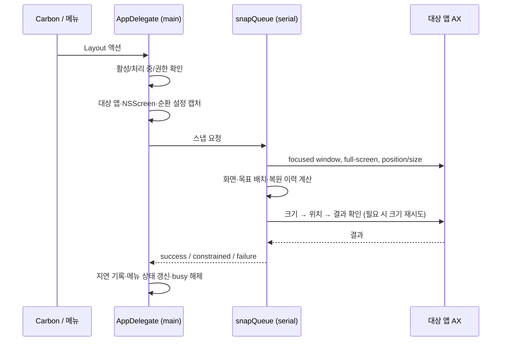

# 아키텍처와 데이터 계약

## 구성

| 파일 | 역할 / 변경 위치 |
| --- | --- |
| `main.swift` | AppDelegate, 메뉴·설정, 로컬 단축키 기록, 대상 앱/화면 캡처, 작업 큐, 진단 UI |
| `Layout.swift` | 안정적인 액션 rawValue, 제목, 비율 계산, 기본 키·표시 |
| `Hotkeys.swift` | Carbon 등록기, 등록·해제·충돌 복구, 저장 마이그레이션 |
| `SnapEngine.swift` | AX 대상 창 읽기·검사·배치, 창별 복원 및 순환 상태 |
| `Placement.swift` | 주입한 resize/move/read 연산의 결과 판정, 좌표 변환·화면 선택·안전 복원 |
| `WindowActions.swift` | 다음 모니터 선택·비례 이동, 마지막 창·방향에 따른 크기 순환 |
| `RestoreHistory.swift` | 최초 창 배치 저장, 오래된 항목 제거, 기본 128개 상한 |
| `LoginItem.swift` | SMAppService 어댑터, 로그인 항목 상태와 등록·해제 |
| `Diagnostics.swift` | 자기 프로세스 메모리·CPU, 최근 100회 스냅 결과, JSON 모델 |
| `Tests/main.swift` | 가짜 등록기/저장소/로그인 항목 및 주입한 배치 연산을 사용하는 검사 실행기 |

## 실행 흐름



`isSnapping`은 메인 스레드에서 관리하며 이미 처리 중이면 새 요청을 큐에 쌓지 않는다. `SnapEngine`의 복원·순환 상태는 해당 직렬 큐에서만 다룬다. 순환 설정 변경에 따른 초기화도 같은 큐에 전달한다. AppKit UI·화면 정보와 로그인 설정 조작은 메인 스레드에서 수행한다.

## 좌표와 화면 선택

- NSScreen은 Cocoa 좌표, AX는 주 화면 상단을 기준으로 한 좌상단 좌표다.
- `yAX = primaryTop - cocoaRect.maxY`. 보조 화면 좌표는 음수일 수 있다.
- Dock·메뉴 막대를 제외한 `visibleFrame`을 사용한다.
- 창과 가장 많이 겹치는 화면을 고르고, 겹침이 없으면 가까운 화면을 고른다.
- 분할은 너비를 각각 반올림하지 않고 공유 경계를 반올림한다.
- 다음 모니터는 작업 영역의 x, 다음 y 좌표 순으로 정렬하고 끝에서 순환한다. 같은 작업 영역은 미러링 중복으로 제거한다. 물리적 인접 방향 이동과는 다르다.
- 이동은 창 위치·크기를 작업 영역 비율로 환산한 뒤 대상 작업 영역에 제한한다.

## 결과·복원·순환

`Placement.Result`는 applied/constrained/failed/unverified다. AX 쓰기 요청이 성공해도 readback이 없으면 성공으로 보고하지 않는다. 현재 위치·크기 비교 허용 오차는 3 point다.

`SnapOutcome`은 success/constrained/failure와 사람이 읽는 메시지다. 현재 개별 AX 오류 코드는 상위로 보존하지 않으므로 더 자세한 진단은 후속 작업이다.

복원 key는 PID와 AXUIElement 비교다. 여러 번 배치해도 첫 위치를 유지하고, 검증된 복원 성공 시에만 항목을 지운다. 일부 작업 실패도 창이 바뀌었을 수 있어 복원 기록을 유지한다. 종료된 앱의 기록은 다음 스냅에서 정리하고, 닫힌 창 항목은 이력 상한 내에 남을 수 있다. 모니터가 분리되어 제목 표시줄에 접근할 수 없으면 현재 작업 영역으로 보정한다.

순환은 마지막 성공 창/액션/화면/목표/인덱스 1개만 보관한다. 좌우에만 ½ → ⅔ → ⅓를 적용한다. 다른 액션, 실패, 화면 변화, 창 기하 변화가 있으면 초기화한다. 수동 이동이 기존 기하와 오차 범위 안에서 동일하면 별도 감지하지 못한다. 순환 상태와 복원 이력은 별개다.

## 단축키 저장 계약

UserDefaults `shortcuts` 값은 JSON을 담은 Data다. 현재 형식은 다음과 같다. 아래 숫자는 키 코드·수정키 비트값이지 자격증명이 아니다.

```json
{"version":2,"bindings":{"left":{"keyCode":123,"modifiers":2304}}}
```

- bindings의 key는 Layout rawValue. 기존 이름을 바꾸려면 명시적 마이그레이션이 필요하다.
- 빠진 액션은 해제된 상태다. 무조건 기본값으로 채우면 사용자 설정을 망가뜨린다.
- 0.1.x 형식은 wrapper 없는 `[String: Shortcut]`이다. 0.2.0은 기존 항목을 보존하고 충돌하지 않는 nextDisplay 기본값만 추가한 뒤 v2로 저장한다.
- v2에서 nextDisplay가 빠졌다면 다시 켜지 않는다.
- 현재 version 필드를 엄격한 호환성 분기에 사용하지는 않는다. 미래 버전·손상 데이터·백업/다운그레이드 정책 강화는 후속 작업이다. 기존 버전으로 되돌리면 새 형식을 읽지 못할 수 있다.
- Carbon 이벤트 ID는 allCases 인덱스+1이고 저장된 키 코드는 UInt32 물리 키 코드다. 새 Layout은 끝에 추가한다.
- 편집 중 전역 등록을 멈추고 검증용 등록을 다시 해제한다. 변경 실패는 이전 바인딩을 복구한다.

그 밖의 UserDefaults: `hasOpened`는 최초 설정 표시 여부, `cycleHorizontalSizes`는 좌우 순환 설정(미지정 시 true)이다. 로그인 실행 상태는 UserDefaults가 아니라 SMAppService가 원본이다. enabled와 requiresApproval을 같다고 취급하지 않는다.

## 리소스·로그 계약

일반 대기에는 권한 폴링 타이머가 없다. 진단은 요청 시 5초 샘플링, 프로파일 모드는 3초 워밍업 후 지정 구간 샘플링이다. CPU는 자기 프로세스의 경과 구간·코어 1개 기준이고 MB는 1,000,000 byte다. footprint와 RSS는 별개다.

지연은 액션 콜백부터 큐·AX·UI 전달까지다. 성공만으로 p95를 계산하며 물리 키 입력·화면 렌더링은 제외한다. 엔진에 제출되기 전 권한 차단·일시정지·busy 무시는 SnapMetrics 항목이 아니다. 단축키 수신·권한 차단 카운터는 별도로 존재한다. 성공이 0회인 경우 현재 지연 요약은 실패 통계를 충분히 표시하지 않는다.

지속 파일 로그·원격 분석·자동 크래시 업로드는 없다. 진단 JSON의 notes는 자유 문자열이며 경로·PID·앱 이름을 포함할 수 있다. 자동 마스킹은 아직 없다.
